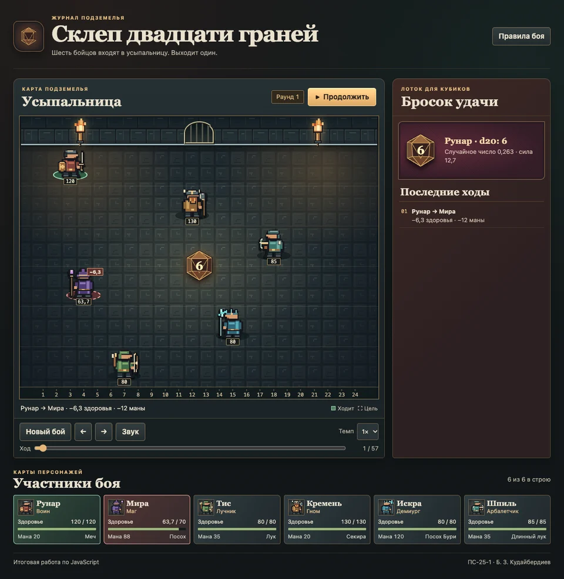

# Склеп двадцати граней

Шесть бойцов спускаются в усыпальницу. Каждый сам выбирает соперника, подходит и атакует. Ты можешь поставить бой на паузу, вернуться к любому ходу и рассмотреть, как менялись позиции, здоровье и оружие. Побеждает последний выживший.

Итоговая работа Кудайбердиева Баясмана Замирбековича по курсу «Разработка на JavaScript», ПС-25-1.



## Запуск

Нужны Node.js 20+, npm и Python 3. Из каталога проекта выполни команды и открой [игру](http://127.0.0.1:8000/).

```sh
npm ci
npm start
```

Нажми **«Начать бой»**. Сплошная зелёная метка обозначает того, кто ходит, пунктирная красная – его цель. Цифра под спрайтом показывает здоровье. По карточке бойца открываются его способность, текущая позиция, дальность и прочность оружия.

**«Пауза»** удерживает текущую фазу. Стрелки и ползунок показывают состояние после выбранного хода. Темп можно увеличить до 2× или 4×. **«Повторить бой»** проигрывает ту же запись, **«Новый бой»** рассчитывает другой исход. Во время атаки d20 ненадолго появляется на поле и приземляется рядом с центром видимой области. В сокращённом движении результат сразу виден в лотке и у цели. Кнопка **«Звук»** включает короткие сигналы удара, блока и уклонения. По умолчанию бой идёт тихо.

## Правила и код

- [Оружие](src/weapons.js) задаёт урон, прочность и дальность. Прочность уменьшается при ударе и блоке, а сломанное оружие заменяется ножом, затем рукой.
- [Персонажи](src/players.js) реализуют шесть классов и их способности. За ход боец выбирает живого противника с наименьшим здоровьем, идёт к нему и пробует атаковать. Блок проверяется раньше уклонения.
- [Движок боя](src/battle.js) использует один порядок ходов для консольного `play(players)` и браузерного `simulateBattle(players)`. Первый печатает события и возвращает победивший экземпляр либо `null`. Второй возвращает начальное состояние, ходы и индекс победителя для просмотра.
- [Интерфейс](app.js) показывает запись. Поле имеет одну ось позиций. У каждого бойца своя визуальная дорожка, поэтому при сближении и перемотке спрайт сохраняет высоту и размер. Кубик отображает реальное случайное число базового урона по шкале `min(20, floor(random × 20) + 1)`. Грань показывает диапазон, а рядом указаны исходное число и сила удара. Движок считает удачу по формуле из задания.

В спорных местах взяты примеры преподавателя. Оружие при нулевой прочности даёт нулевой вклад в урон. Дальность включает граничную позицию. При совпадении позиций расстояние считается равным единице, цель отскакивает вправо и получает одну атаку удвоенной силы. Воин при срабатывании способности принимает удар на ману, пока её запас положителен, а гном считает удары, прошедшие защиту. При равном здоровье выбирается первый соперник в порядке списка. После 250 раундов без победителя фиксируется ничья.

Для проверки из консоли можно запустить отдельный поединок.

```sh
node --input-type=module -e 'import { play, Warrior, Mage } from "./src/index.js"; play([new Warrior(0, "Рунар"), new Mage(3, "Мира")]);'
```

## Проверка

```sh
npm test
```

Jest проверяет значения характеристик, наследование, пороги способностей, порядок атаки, расход прочности, выбор цели, ход боя и сохранение снимков. Порог покрытия – 70% строк движка.

[Первичное условие преподавателя](https://github.com/vovachebr/bhebdps-ojs/blob/master/Домашние%20задания/5%20Итоговое%20задание/README.md)

Спрайты и плитки в [assets](assets) нарисованы для проекта на сетке 32×32. Арена использует оригинальных персонажей, собственный рисунок и системные шрифты. [OpenAI Codex](https://openai.com/codex/) использовался как вспомогательный инструмент для реализации и проверки игры. Он помог подготовить код, тесты, спрайты и документацию. Механики сверили с исходным ТЗ, а игровой путь и масштабирование проверили в Chrome.
